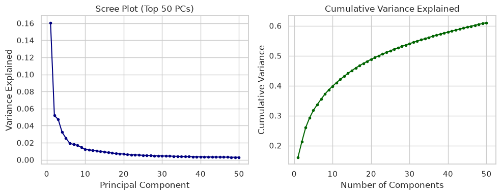
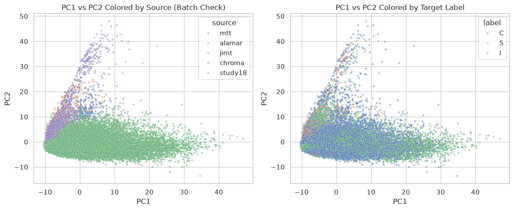
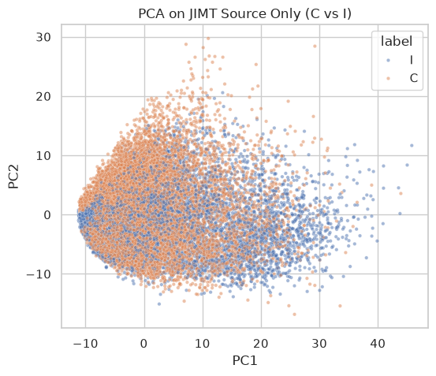
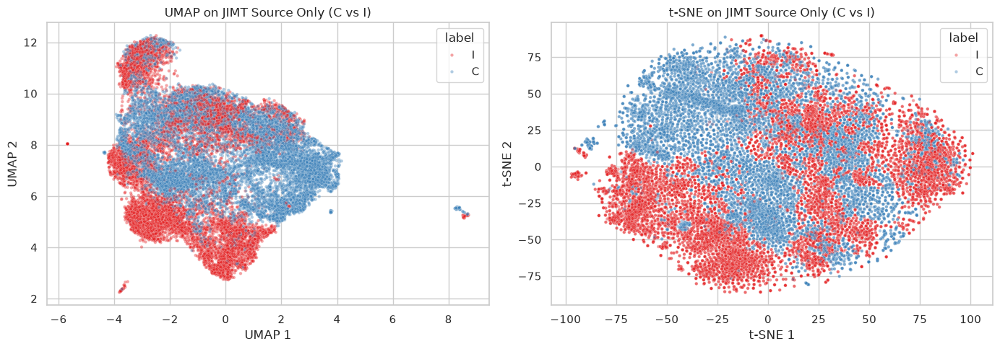
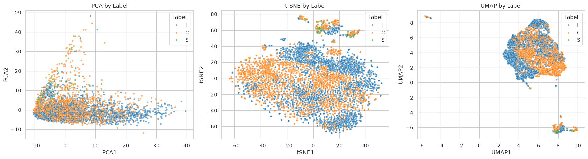
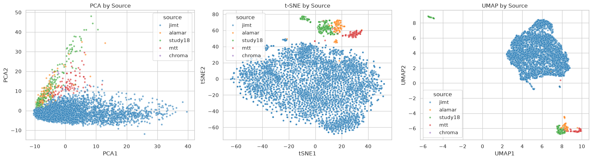

Dataset Diagnostics

The dataset contains 23845 observations and 515 columns: 3 metadata columns (source, label, Value) and 512 deep learning feature embeddings. 
Labels are heavily dominated by classes I (11987) and C (11591) at approximately the same proportions, the minority class is S with only 276 observations. The classes are also highly unbalanced across studies. The jimt source accounts for 91.6% of all data (21848 samples), containing only classes C and I. While class S is almost exclusively present in study18 (198 / 276) and mtt (58 / 276). This introduces a possible bias for classification if the technical batch effect takes place - the model may account for possibly strong technocal batch effect rather than true biological signal.

PCA

Computing top 50 principal components shows that variance explained by individual components starts at 0.16 for PC1 and rapidly drops to near zero values by the 20th PC. Cumulative variance across 50 components does not exceed 0.61, indicating that variance is distributed across a high-dimensional space.

When colored by class 'label', 2D PCA shows no clear separation between C and I - data points overlap heavily. This may be due to PCA's linear transformations fail to capture non-linear (as expected) biological relationships present in data.
When colored by source, strong batch separation is observed - technical variance dominates.

To check if 2D global representations and label-source imbalances deteriorated the view, I isolated the jimt source. PCA within jimt still failed to separate classes, again suggesting that the relationship between features and labels is likely non-linear. Applying non-linear t-SNE and UMAP locally within this single source worked significantly better.

Dimensionality Reduction

- PCA forms a single continuous cloud. C and I points are  intermingled,  minority class S dispersed along the uppertail. 
- t-SNE resolves distinct sub-cluster and some boundaries. I forms a dominant region on the right , C concentrates on the left with a substantial overlap zonein the middle.
- UMAP isolated two smaller outlying clusters at the top and bottom right, which correspond directly to minority batches and class S. The primary central island contains almost exclusively jimt data, indicating that technical batch still has stronger signal than the biological diference.

