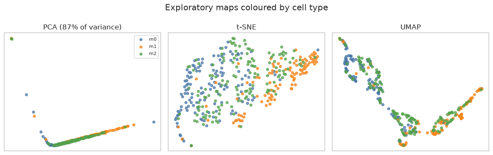
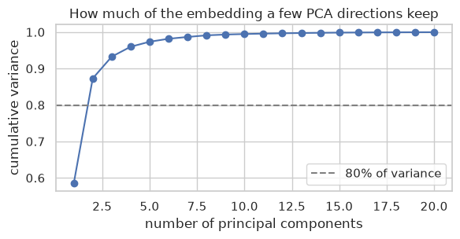
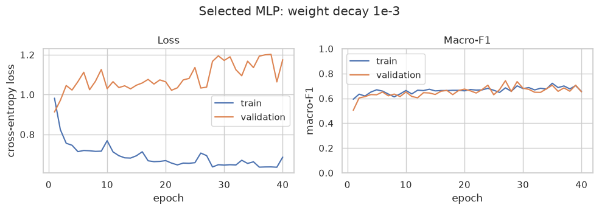
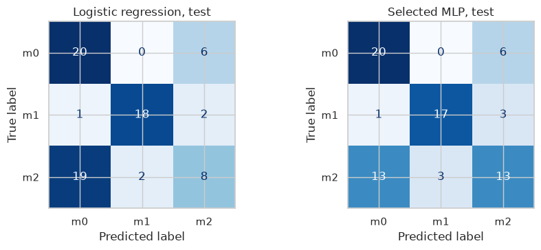

## Prcatical 6 report

### 1. What does the VGG3D embedding table contain, and what data-preparation problems did you find?
The file has 381 objects and 128 embedding valies + cell_type (a prediction target) and sample_group (metadata/batch). Class counts are m0 = 132, m1 = 104, m2 = 145.

Preparation findings:
- There are no missing values and no duplicate rows.
- 37 embedding columns are always 0. They were removed. A constant column cannot separate cell types, it does not carry information and dividing by its standard deviation is not safe.
- The remaining features use different scales (min 0, max ~45), so training set standardisation is needed.
- There are 85 sample groups, each of them contains a single cell type. Group size ranges from 1 to 22 objects (median=3). sample_group is used only for the split.
- After the split, train, validation and test share no groups/batches to prevent leackage and too optimistic scores. Train has 230 objects, validation 75, test 76.
### 2. Does the embedding space show separation between `m0`, `m1`, and `m2`? Is the separation also visible across sample groups?

PCA lays most objects on one curved line with a few points far from the majority. m1 runs farther along it; m0 and m2 sit on top of each other. t-SNE and UMAP keep local neighbours together and show the same partial split: m1 gathers toward right side, m0 to the left, but also mixes with m2, which already may indicate that class m2 might be problematic for the prediction.

The first two PCA axes already keep 87% of the variance, which is why 2 components are enough to pass 80%.

### 3. How much does the MLP improve over logistic regression, and what evidence supports the comparison?
Validation macro-F1 is 0.67 for logistic regression and 0.742 for the selected MLP (weight decay 1e-3). Validation balanced accuracy is 0.66 and 0.737.
Test macro-F1 is 0.613 (logistic regression) and 0.669 (MLP). Test balanced accuracy is 0.634 and 0.676. On the test set the MLP is ahead by 0.055 macro-F1.
Both numbers come from the same group-aware split. Logistic regression was not tuned. The MLP settings were chosen on validation before (adjusted learning rate, weight decay and neural network size).
| model | split | accuracy | balanced_accuracy | macro_f1 |
| :--- | :--- | :--- | :--- | :--- |
| logistic regression | validation | 0.653333 | 0.660256 | 0.670479 |
| logistic regression | test | 0.605263 | 0.634079 | 0.613222 |
| MLP (weight decay 1e-3) | validation | 0.733333 | 0.736569 | 0.742119 |
| MLP (weight decay 1e-3) | test | 0.657895 | 0.675677 | 0.668580 |
### 4. Which learning rate, capacity, and regularisation setting worked best? Did the MLP overfit?
The learning-rate sweep on the (32, 16) net selected lr = 0.01 by validation macro-F1. The capacity comparison then selected hidden layers (16,). The overall winner on the validation table is weight decay 1e-3 (dropout 0.0, weight decay 0.001, patience none, best epoch 27 of 40).
| name | learning_rate | hidden_dims | dropout | weight_decay | best_epoch | train_macro_f1 | val_macro_f1 | val_balanced_accuracy | val_loss |
| :--- | :--- | :--- | :--- | :--- | :--- | :--- | :--- | :--- | :--- |
| weight decay 1e-3 | 0.0100 | (16,) | 0.0 | 0.001 | 27 | 0.684658 | 0.742119 | 0.736569 | 1.037272 |
| small (16,) | 0.0100 | (16,) | 0.0 | 0.000 | 29 | 0.695543 | 0.719527 | 0.707875 | 1.134254 |
| early stopping, patience 8 | 0.0100 | (16,) | 0.0 | 0.000 | 29 | 0.695543 | 0.719527 | 0.707875 | 1.134254 |
| large (64, 32) | 0.0100 | (64, 32) | 0.0 | 0.000 | 38 | 0.698318 | 0.712449 | 0.724664 | 1.136992 |
| lr=0.01 | 0.0100 | (32, 16) | 0.0 | 0.000 | 23 | 0.676300 | 0.711970 | 0.715812 | 1.151207 |
| dropout 0.3 | 0.0100 | (16,) | 0.3 | 0.000 | 32 | 0.673989 | 0.685835 | 0.692002 | 1.140245 |
| reference | 0.0010 | (32, 16) | 0.0 | 0.000 | 38 | 0.661241 | 0.652047 | 0.649267 | 1.053479 |
| lr=0.001 | 0.0010 | (32, 16) | 0.0 | 0.000 | 38 | 0.661241 | 0.652047 | 0.649267 | 1.053479 |
| lr=0.1 | 0.1000 | (32, 16) | 0.0 | 0.000 | 33 | 0.613629 | 0.639896 | 0.654151 | 1.128627 |
| lr=0.0001 | 0.0001 | (32, 16) | 0.0 | 0.000 | 33 | 0.589722 | 0.529235 | 0.534799 | 1.384950* |

The model has partly overfitted (relates to winner model (displayed on a plot above) - dropout 0.0, weight decay 0.001, patience none, best epoch 27). At 27th epoch, macro-F1 is 0.685 on the training rows and 0.742 on validation, so the class calls are not worse on the held-out samples. The loss is still higher on validation (1.037) than on train (0.693) - the probabilities are more precise on rows which network has already seen. Validation loss also rises after epoch 27, which is why those weights are kept instead of the final epoch (I percieve it as a mild overfit). The training set has 230 objects and 91 features, so a wide network has room to memorise sample-specific patterns. The solution is to keeping the epoch with the best validation macro-F1.

### 5. Which cell types are confused most often, and do the errors concentrate in particular sample groups?
The most common MLP mistake on the test set is m2 predicted as m0 (13 objects). Test recall is 0.769 for m0, 0.810 for m1, and 0.448 for m2. m1 is the easy class. m2 is the class the model misses, usually by calling it m0. Of 26 mistaken test objects, 15 correspond to the 3 weakest samples: sample_group_056 (true m2, 1/3 correct), sample_group_081 (true m2, 5/13 correct), sample_group_015 (true m2, 4/9 correct). Probably because each sample has only one true label, a weak group is a whole held-out experiment. sample_group_081 is large (13 test objects), so it contributes more mistakes than a small sample with the same accuracy. The errors are concentrated in a few m2 samples rather than sprinkled evenly across every test group.

### 6. What biological or technical information is missing that could help explain the remaining errors?
- There is no information about the biological nature of classes m0, m1 and m2. This knowledge could cave provided understanding why m2 is recognized so poorly.
- The embedding verctors/encoding seem to be not adapted to these cells, as 37 of 128 channels are dead, which suggests the encoder only partly matches to the experiment. I assume that some other more suitable encoding method may have provided nore explained variance between the classes and would help seperate class m2 from m0 to better extent.