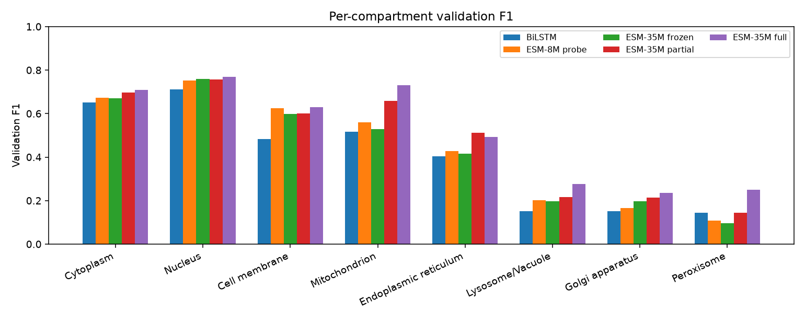
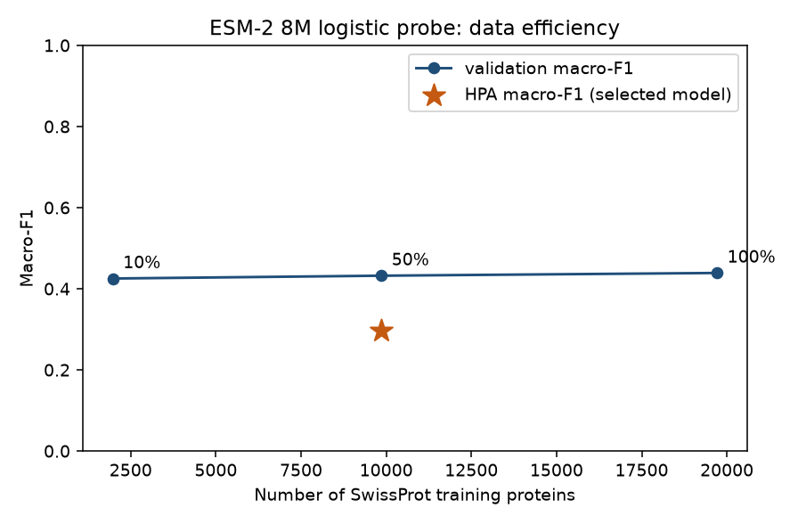
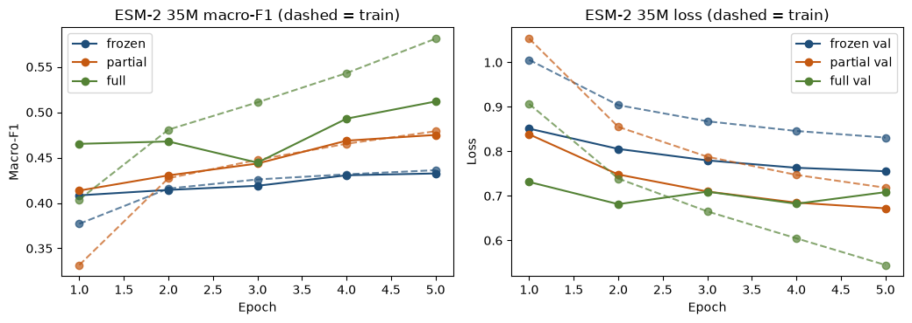

## Part A - Reproduce and document a baseline

- Which metric is most informative for this imbalanced multi-label problem, and why?

In the dataset there is a significant class imbalance, that is why considering multiple evaluation metrics matters. Cytoplasm and nucleus each cover about 40% of training proteins; peroxisome covers 1.3% (251 proteins). Micro-F1 adds up all TPs, FPs and FNs togather before computing F1, which penalizes individual incorrect predictions less but limits informaion about mistakes in poorly represented classes like peroxisomes. That is the reason why micro-F1 is higher than macro-F1, which is weighted, and has a value of ~0.5+ when the exact match is low (0.12). Regarding exact match, protein only counts as correct if all binary predictions match the ground truth simultaneously. pos_wight forces the model to make positive guesses to rare compartments like peroxisomes, leading to high recall and low presicion in such classes as well as low exact-match scores, despite moderate micro-F1.

Probably, macro-F1 is the most relevant for the evaluation because it gives each compartment the same weight and highlights problematic classes instead of smoothing their negative scores, which gived more realistic view on the model performance.

- Which localization labels are easiest and hardest for the baseline?

In validation both baselines models rank compartments in similar way. Nucleus is easiest (BiLSTM F1 0.711, probe 0.751), then cytoplasm (0.650 and 0.672). Biological explanation for good scores in nuclear protein may be that nuclear proteins are mostly TFs or just contain DNA/RNA-binding motifs, which the model could have learned well. Mitochondrian and cell membrane sit in the middle. Lysosome, Golgi, and peroxisome are the hardest set: validation F1 is 0.11–0.20 for the ESM+logistic and about 0.14–0.15 for the BiLSTM. The same three compartments stay low on HPA. HPA lysosome F1 is not interpretable on its own because the support is 2, which is insufficient to obrain reasonable scores for evaluation.

- Does the model tend to miss labels or produce false positive labels?

False positives. On the BiLSTM validation there are 7621 FP labels and 1132 missed labels. ESM+logistic has approximately the same results (6323 vs 1305). Recall on the rare compartments is high and precision is low: peroxisome validation precision is 0.081 for the BiLSTM and 0.058 for ESM+logistic, with recall 0.68 and 0.72. pos_weight and class_weight='balanced' push the decision toward calling a rare compartment positive. At the fixed threshold 0.5 models overcall rare labels.

## Part B - Data-efficiency experiment

- At which training fraction do the performance gains begin to level off?

At 10-50% of the training set. Validation macro-F1 is 0.425 at 1971 proteins, 0.432 at 9854, and 0.439 at 19708. Each dataset size increasing step adds 0.007 macro-F1.

Because ESM-2 already learned important patterns during pretraining, linear probe learns almost everything it can from 10-50% of data. Doubling the dataset size repeatedly yields tiny gains, showing that frozen embedding acts as bottleneck, not the dataset size.

The 10% subset is 0.014 below the full probe, outside the 0.01 selection band, so 50% model with 9854 proteins was selected.

- Does the data-efficient model generalize to HPA in the same way as it performs on validation?

The selected 50% probe reaches 0.432 on validation and 0.296 on HPA (gap = 0.136). For comparison, the full probe from Part A scores 0.439 on validation and 0.299 on HPA (gap = 0.140). Since both validation and HPA scores move in sync, training on half the data doesn't cause extra overfitting to SwissProt, and using all the data doesn't close the generalization gap on HPA either.

- What does this suggest about the value of additional labeled proteins?

Once a few thousand SwissProt proteins are included, a linear classifier on frozen 8M embeddings stops improving. The real bottleneck is the fixed representation and the shift to HPA, not a lack of labels.

## Part C - Frozen versus fine-tuned ESM-2

| Model | Training mode | Trainable parameters | Max length | Batch size | Val macro-F1 | HPA macro-F1 | Time/epoch (s) | Peak GPU memory (MiB) |
| :--- | :--- | ---: | ---: | ---: | ---: | ---: | ---: | ---: |
| BiLSTM | from scratch | 202,120 | 1000 | 64 | 0.401 | 0.266 | 17.1 | 583 |
| ESM-2 8M + logistic probe | frozen embeddings | 2,568 | 1000 | — | 0.439 | 0.299 | 19.5 | 0 |
| ESM-2 35M + head | frozen | 3,848 | 400 | 32 | 0.433 | 0.304 | 57.1 | 619 |
| ESM-2 35M | partial | 5,545,928 | 400 | 32 | 0.475 | 0.322 | 72.5 | 1892 |
| ESM-2 35M | full | 33,504,249 | 400 | 32 | 0.512 | 0.349 | 144.6 | 8123 |

- Does fine-tuning improve over a frozen backbone?

Yes, val macro-F1 moves from 0.433 (frozen) to 0.475 (last two blocks) to 0.512 (full). HPA macro-F1 moves from 0.304 --> 0.322 --> to 0.349. HPA micro-F1 and exact match improve as well. 

- Is the improvement large enough to justify the additional compute?

Full fine-tuning updates 33.5M parameters (vs 3848 for the frozen ESM-2 35M), taking 2.5 times longer per epoch and using 10x+ more GPU memory. Partial fine-tuning falls in between at 5.5M parameters, 73 s per epoch (while ESM-2 35M + head with frozen embeddings takes 57.1), 1892 MiB, and 0.322 HPA macro-F1. 

Full fine-tuning is optimal when maximizing HPA score on standard GPU (~10–12 GB VRAM), whereas partial fine-tuning is ideal on smaller (≤8 GB) GPUs. Even so, an HPA macro-F1 of 0.349 shows that extra compute doesn't solve the rare-compartment problem.

- Which model has the best validation-to-HPA generalization?

| Model | Training mode | Val macro-F1 | Val micro-F1 | Val exact-match | HPA macro-F1 | HPA micro-F1 | HPA exact-match | Best epoch |
| :--- | :--- | ---: | ---: | ---: | ---: | ---: | ---: | ---: |
| BiLSTM | from scratch | 0.401 | 0.524 | 0.120 | 0.266 | 0.407 | 0.065 | 6 |
| ESM-2 8M + logistic probe | frozen embeddings | 0.439 | 0.549 | 0.216 | 0.299 | 0.467 | 0.138 | — |
| ESM-2 35M + head | frozen | 0.433 | 0.538 | 0.173 | 0.304 | 0.444 | 0.113 | 5 |
| ESM-2 35M | partial | 0.475 | 0.576 | 0.242 | 0.322 | 0.471 | 0.167 | 5 |
| ESM-2 35M | full | 0.512 | 0.626 | 0.337 | 0.349 | 0.534 | 0.239 | 5 |

Frozen 35M model shows a smaller validation-to-HPA gap probably due to its validation score is weaker from the beggining - full fine-tuning still reaches the best HPA macro-F1 (0.349). Across every model, the drop to HPA remains around 0.13-0.16, showing that fine-tuning raises overall performance retaining learned biological patterns/information. Since tiny sample sizes in lysosome (2) and peroxisome (7) add noise to HPA macro-F1, the improvements in HPA micro-F1 and exact-match are better evidence that full fine-tuning generalizes better.

- Which classes benefit from fine-tuning, and which remain difficult?

Full fine-tuning mainly improves compartments that the frozen head missed. On validation the biggest gains are in mitochondria (+0.201), peroxisome (+0.154), and lysosome (+0.080), while already strong or abundant classes like Nucleus stay almost flat. HPA shows a similar pattern, although rare compartments like peroxisome and lysosome remain weak overall (support 2). Partial unfreezing captures most of the mitochondrion gain (+0.129 on validation) but lags behind full fine-tuning on peroxisome.

- What evidence of overfitting can you see in the learning curves?

The frozen head and partial runs show minimal overfitting (train and validation macro-F1 stay close, with validation loss still falling at epoch 5), whereas full fine-tuning begins to diverge: validation loss reaches its minimum at epoch 2 (0.681) before rising to 0.708 at epoch 5, with train macro-F1 slightly above validation. Even with mild signs of overfitting, epoch 5 still produces the strongest validation macro-F1.